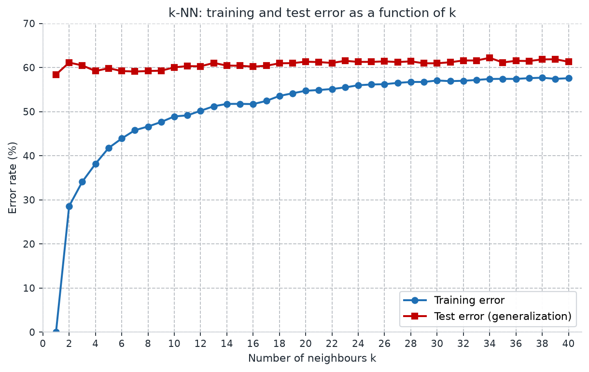
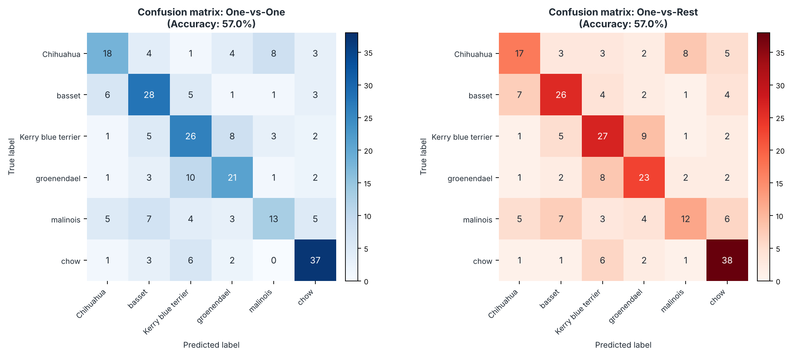
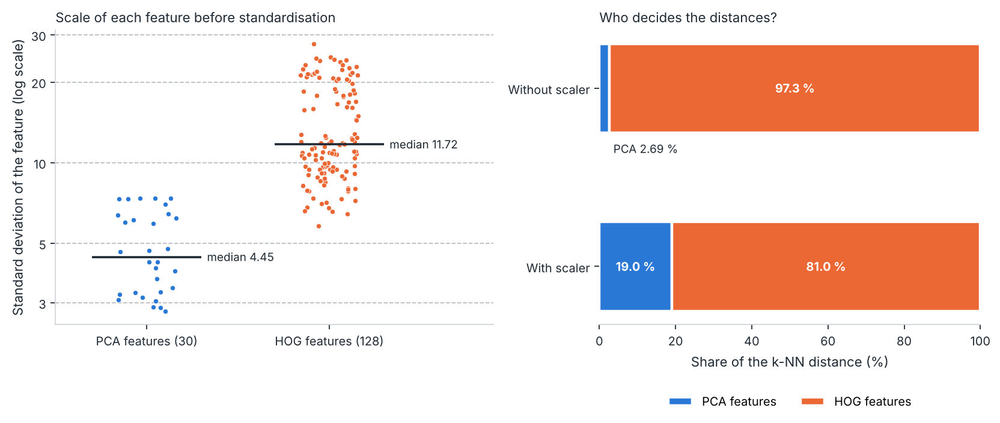
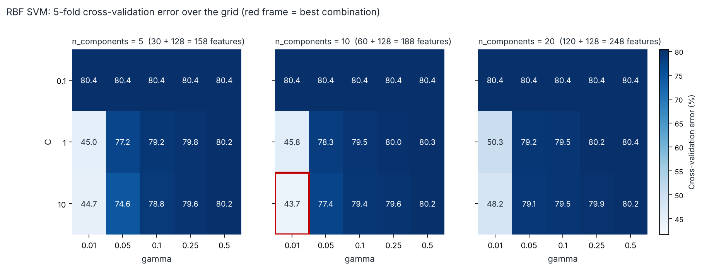

# Classification de races de chiens from scratch : PCA, HOG, k-NN et SVM

Classification fine de **6 races de chiens** (Chihuahua, basset, Kerry blue terrier,
groenendael, malinois, chow) à partir d'images 64x64 en niveaux de gris, en utilisant uniquement
du machine learning et du traitement d'image classiques (pas de deep learning).

Les images viennent de SmallDB, un extrait du jeu [Stanford Dogs](http://vision.stanford.edu/aditya86/ImageNetDogs/).
Le projet suit la structure d'un cours d'introduction au machine learning et a été retravaillé
pour un cours de Digital Image Processing : la PCA, les filtres de Sobel et le HOG sont codés à la main,
puis branchés dans une pipeline scikit-learn.

## Résultats

Split stratifié 75/25 (751 train / 251 test, seed 42). Le hasard donne 83 % d'erreur.

| Modèle | Erreur de test |
|---|---|
| Toujours prédire la plus grande classe | 80,5 % |
| k-NN (k = 5), features PCA + HOG | 59,8 % |
| SVM linéaire (C = 1) | 54,2 % |
| SVM RBF (C = 1, gamma = "scale") | 40,2 % |
| SVM RBF réglé par GridSearchCV (n = 10, C = 10, gamma = 0,01) | 43,0 % |
| Idem, One-vs-One / One-vs-Rest | 43,0 % / 43,0 % |

Sur 10 splits aléatoires, le SVM RBF par défaut atteint 43,4 % (+/- 2,8) et le SVM réglé
44,3 % (+/- 2,7) : le réglage n'apporte rien. Le facteur limitant, ce sont les features, pas le classifieur.

### Figures principales

| | |
|---|---|
|  |  |
| Erreur d'entraînement et de test du k-NN en fonction de k | Matrices de confusion, One-vs-One et One-vs-Rest |
|  |  |
| Sans standardisation, le HOG décide de 97 % de la distance | Erreur de validation croisée sur la grille (n, C, gamma) |

Toutes les figures sont dans `results/figures/` (légendes en anglais).

## Méthode

1. **Équilibre des classes** : entropie de Shannon de la distribution (0,997 de son maximum).
2. **Prétraitement** : recadrage autour de la boîte annotée (le plus grand chien s'il y en a plusieurs),
   passage en niveaux de gris, redimensionnement en 64x64 par *letterbox* (ratio conservé, bandes noires).
3. **PCA** (codée à la main, via la SVD) : analyse de la variance et reconstruction.
4. **Sobel + HOG** (codés à la main) : cellules 16x16, 8 orientations non signées, 128 valeurs par image.
5. **Pipeline** : min-max, puis PCA par classe (5 composantes par race = 30 valeurs) concaténée
   au HOG (128 valeurs), puis standardisation, puis classifieur. Tout est appris sur le train
   uniquement : pas de fuite de données.
6. **k-NN** : erreur en fonction de k, avec k choisi par validation croisée dans le train.
7. **Étude de la standardisation** : ce que deviennent les distances quand on la retire.
8. **SVM** : noyaux linéaire et RBF, `GridSearchCV` sur le nombre de composantes PCA, C et gamma,
   puis One-vs-One contre One-vs-Rest.

## Structure du projet

```
src/dogbreeds/        code réutilisable (installé avec pip install -e .)
    data.py           chemins, chargement, split stratifié
    preprocessing.py  recadrage, niveaux de gris, letterbox
    pca.py            PCA via SVD
    hog.py            Sobel et HOG
    features.py       transformateurs scikit-learn : PCA par classe, HOG
    pipeline.py       build_pipeline(...)
    metrics.py        entropie, similarité cosinus
    plotting.py       style des figures
scripts/              un script par expérience
tests/                tests pytest
results/figures/      figures produites par les scripts
data/                 voir data/README.md
```

## Lancer le projet

```bash
pip install -e .
# placer le jeu de données dans data/SmallDB (voir data/README.md)

python scripts/prepare_data.py     # recadrage + letterbox, écrit data/processed/smalldb_64.npz
python scripts/class_balance.py
python scripts/preprocessing_demo.py
python scripts/pca_analysis.py
python scripts/hog_features.py
python scripts/knn_baseline.py
python scripts/scaling_effect.py
python scripts/svm_tuning.py       # environ une minute (225 entraînements)
pytest
```

Les scripts se lisent dans cet ordre ; chacun affiche ses chiffres et sauvegarde ses figures.

## Limites

- Niveaux de gris uniquement : la couleur du poil est un indice fort entre ces races et elle est perdue.
- Les images 64x64 perdent la texture fine, et 1002 images, c'est peu pour de la reconnaissance fine.
- **Artefact du letterbox** : les bandes noires dépendent du ratio du recadrage, et le HOG les capte.
  La première composante principale des features HOG a une corrélation de 0,88 avec le log du ratio,
  donc une partie du signal décrit la forme de la boîte, pas le chien.
- Le k-NN souffre des distances en grande dimension ; le SVM à noyau RBF s'en sort mieux mais
  est déjà proche de ce que ces features permettent.
- Suite naturelle : un CNN avec transfer learning, qui serait la comparaison honnête.

## Contexte

Construit à partir des TP d'un cours d'introduction au Machine Learning en Python (Polytech Nice Sophia),
puis prolongé pour un cours de Digital Image Processing à l'Université de Chongqing.
